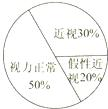

# Mathematics (Grade 6)

**ID**: 804bc4a4
**难度**: medium_hard
**题型**: multiple_choice

## 题目
如图是某年级同学视力情况统计图，已知近视的有60人，视力正常的有(  )人．
A．180人
B．120人
C．100人
D．300人

## 解答

**答案**: C

1. Step1:根据已知条件，近视人数为60人，且近视人数占总人数的30%，所以用近视人数除以其占比可求出总人数，即总人数 = 60÷30%
2. Step2:由统计图可知视力正常的人数占总人数的50%，那么用求出的总人数乘50%就能得到视力正常的人数，即视力正常人数 = 60÷30%×50%
3. Step3:计算60÷30%×50% = 200×50% = 100人

## 知识点

**知识点**:
  - 扇形统计图．

---
