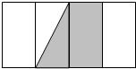

# Mathematics (Grade 6)

**ID**: 8072a3de
**难度**: medium_hard
**题型**: multiple_choice

## 题目
下面几个分数中，（  ）可以表示图中的阴影部分．

$\begin{description}
\item A．\frac{1}{2}\item B．\frac{3}{8}\item C．\frac{1}{3}
\end{description}$

## 解答

**答案**: B

1. Step1:观察图形可知，长方形被平均分成了4份，每份可表示为$rac{1}{4}$
2. Step2:分析阴影部分，发现其占了1份和另外1份的一半
3. Step3:计算阴影部分，即$rac{1}{4}$加上$rac{1}{4}$的一半，$rac{1}{4}$+$rac{1}{4}$÷2=$rac{3}{8}$
4. Step4:对比选项，得出答案为B

## 知识点

**知识点**:
  - 分数的意义、读写及分类．

---
