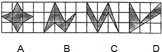

# Mathematics (Grade 6)

**ID**: 844da81b
**难度**: medium_hard
**题型**: multiple_choice

## 题目
图中每个小方格表示1平方厘米，左起第(  )个图形的面积与其他三个不相等．

A．A
B．B
C．C
D．D

## 解答

**答案**: C

1. Step1:明确每个小方格面积为1平方厘米
2. Step2:计算A图形面积，通过数方格可得为3平方厘米
3. Step3:计算B图形面积，通过数方格可得为3平方厘米
4. Step4:计算C图形面积，通过数方格可得为2.5平方厘米
5. Step5:计算D图形面积，通过数方格可得为3平方厘米
6. Step6:比较四个图形面积，发现A、B、D图形面积均为3平方厘米，C图形面积为2.5平方厘米，所以C图形面积与其他三个不相等

## 知识点

**知识点**:
  - 组合图形的面积．

---
