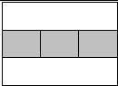

# Mathematics (Grade 6)

**ID**: 84a1e913
**难度**: medium_hard
**题型**: multiple_choice

## 题目
图中的阴影部分可以用$\frac{1}{3}$表示，还可以用$\underline{\hspace{2em}}\underline{\hspace{2em}}$表示．(  )

A．$\frac{3}{5}$
B．$\frac{3}{9}$
C．$\frac{2}{6}$
D．$\frac{2}{3}$

## 解答

**答案**: B

1. Step1:把大长方形面积看作单位‘1’，观察发现若平均分为3份，阴影部分占1份，根据分数的意义可得阴影部分占比为1÷3 = $\frac{1}{3}$
2. Step2:思考大长方形还可怎样平均分，发现也可看作平均分为9份
3. Step3:确定当大长方形平均分为9份时，阴影部分占3份，根据分数的意义可得阴影部分占比为3÷9 = $\frac{3}{9}$
4. Step4:对比选项，找到与$\frac{3}{9}$对应的选项为B

## 知识点

**知识点**:
  - 分数的意义、读写及分类．

---
