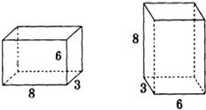

# Mathematics (Grade 6)

**ID**: 862d94c7
**难度**: medium_hard
**题型**: multiple_choice

## 题目
有一个密闭的油箱，它的长、宽、高分别是8分米、3分米、6分米、先在箱里装油深2分米，如果把这个油箱立起来，则油深（  ）分米．
A．$\frac{7}{3}$
B．$\frac{8}{3}$
C．$\frac{11}{3}$
D．4

## 解答

**答案**: B

1. Step1:根据油箱横放时长8分米、宽3分米、油深2分米，利用长方体体积公式V = a×b×h（其中a为长，b为宽，h为高），计算油的体积为8×3×2 = 48立方分米
2. Step2:当油箱立起来后，此时油箱的底面积为长6分米、宽3分米，根据长方形面积公式S = a×b（其中a为长，b为宽），算出此时油箱的底面积为6×3 = 18平方分米
3. Step3:因为油的体积不变，用油的体积48立方分米除以油箱立起来后的底面积18平方分米，即48÷18 = $\frac{8}{3}$分米，得到立起来后油的深度

## 知识点

**知识点**:
  - 长方体、正方体表面积与体积计算的应用．

---
