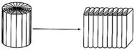

# Mathematics (Grade 6)

**ID**: 87170bcc
**难度**: medium_hard
**题型**: multiple_choice

## 题目
如图，把一个圆柱体切割后拼成的近似长方体，表面积会（  ）
$\begin{description}
\item A．增加\item B．减少\item C．不变
\end{description}$

## 解答

**答案**: A

1. Step1:明确题目是比较圆柱体切割后拼成近似长方体的表面积变化情况
2. Step2:依据圆柱体切割后拼组成长方体的方法，知道拼组后体积不变
3. Step3:确定拼组后表面积比原来圆柱的表面积增加了两个以圆柱的底面半径和高为边长的长方形的面积
4. Step4:得出表面积会增加的结论，对应选项A

## 知识点

**知识点**:
  - 圆柱的侧面积、表面积和体积．

---
