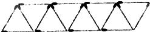

# Mathematics (Grade 6)

**ID**: 8c9fb577
**难度**: medium_hard
**题型**: multiple_choice

## 题目
如图，用火柴棍拼成一排由三角形组成的图形，如果图形中含有16个三角形，则需要（  ）根火柴棍．

A．30根
B．31根
C．32根
D．33根

## 解答

**答案**: D

1. Step1:观察图形可知，摆1个三角形需要3根火柴棍
2. Step2:发现规律，在3根的基础上，每增加一个三角形就多2根火柴棍
3. Step3:当有2个三角形时，火柴棍数量为3 + 2 = 5根
4. Step4:当有3个三角形时，火柴棍数量为3 + 2×2 = 7根
5. Step5:以此类推，当有n个三角形时，火柴棍数量的表达式为3 + (n - 1)×2
6. Step6:题目中n = 16，将其代入表达式3 + (16 - 1)×2
7. Step7:先计算括号内16 - 1 = 15
8. Step8:再计算15×2 = 30
9. Step9:最后计算3 + 30 = 33根
10. Step10:对比选项，答案为D

## 知识点

**知识点**:
  - 数与形结合的规律．

---
