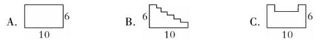

# Mathematics (Grade 6)

**ID**: 8d0bec76
**难度**: medium_hard
**题型**: multiple_choice

## 题目
下面图形中，周长最长的是（）

## 解答

**答案**: C

1. Step1:观察选项A，可知其图形的周长是一个长为10，宽为6的长方形的周长
2. Step2:观察选项B，通过平移可知其图形的周长可拼成一个长为10，宽为6的长方形的周长
3. Step3:观察选项C，通过平移可知其图形的周长可拼成一个长为10，宽为6的长方形的周长加上竖着的两条短边的长
4. Step4:比较三个选项图形的周长，因为选项C的周长是长方形周长加两条短边的长，选项A和B的周长只是长方形的周长，所以选项C的周长最长

## 知识点

**知识点**:
  - 巧算周长(奥数)

---
