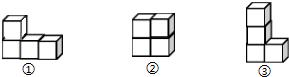

# Mathematics (Grade 6)

**ID**: 8d6a3d79
**难度**: medium_hard
**题型**: multiple_choice

## 题目
从左侧面观察下面的物体，哪两个看到的形状相同(  )

A．①和②
B．②和③
C．①和③

## 解答

**答案**: A

1. Step1:观察图形①，从左侧面看，看到的是一列2个正方形
2. Step2:观察图形②，从左侧面看，看到的是一列2个正方形
3. Step3:观察图形③，从左侧面看，看到的是一列3个正方形
4. Step4:对比①②③从左侧面看到的形状，发现①和②看到的形状相同，都是一列2个正方形
5. Step5:根据上述对比结果，得出答案为A

## 知识点

**知识点**:
  - 从不同方向观察物体和几何体．

---
