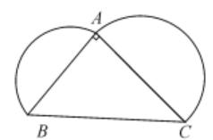

# Mathematics (Grade 6)

**ID**: 8da6f05d
**难度**: medium_hard
**题型**: multiple_choice

## 题目
如图，以直角三角形ABC的两条直角边为直径作两个半圆，已知这两段半圆弧的长度之和是37.68厘米，那么△ABC的面积最大是（）平方厘米（π取3.14）。

A.36
B.48
C.60
D.72

## 解答

**答案**: D

1. Step1:根据圆的周长公式C=πd，两段半圆弧的长度之和为3.14×(AB + AC)÷2，已知两段半圆弧的长度之和是37.68厘米，所以得到等式3.14×(AB + AC)÷2 = 37.68
2. Step2:由等式3.14×(AB + AC)÷2 = 37.68，计算AB + AC的值，即AB + AC = 37.68×2÷3.14 = 24厘米
3. Step3:因为三角形ABC是直角三角形，面积S = AB×AC÷2，要使面积最大，根据数学原理AB与AC需最接近，已知AB + AC = 24厘米，所以确定AB = AC = 12厘米
4. Step4:根据三角形面积公式S = AB×AC÷2，将AB = AC = 12厘米代入，计算三角形ABC的面积最大值为12×12÷2 = 72平方厘米
5. Step5:对比选项，得出答案为D

## 知识点

**知识点**:
  - 圆的周长;三角形的面积

---
