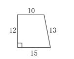

# Mathematics (Grade 6)

**ID**: 8dafa04b
**难度**: medium_hard
**题型**: multiple_choice

## 题目
求如图梯形的面积，算式正确的是（）
A.(10+12)×12÷2
B.(12+13)×10÷2
C.(10+15)×13÷2

## 解答

**答案**: A

1. Step1:明确这是一个求梯形面积算式正确性的问题
2. Step2:根据梯形面积公式为(上底+下底)×高÷2
3. Step3:判断此直角梯形中高为12，上底为10，下底为15
4. Step4:将上底、下底和高代入公式得到(10+15)×12÷2
5. Step5:对比选项，确定A选项正确

## 知识点

**知识点**:
  - 

---
