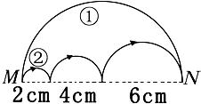

# Mathematics (Grade 6)

**ID**: 8e8d529c
**难度**: medium_hard
**题型**: multiple_choice

## 题目
下图中从M到N，路线①与路线②相比，（  ）

$\begin{description}
\item A．走路线①远\item B．走路线②远\item C．一样远
\end{description}$

## 解答

**答案**: C

1. Step1:分析路①的长度，它是直径为(2 + 4 + 6) = 12厘米的半圆的弧长，根据圆的周长公式C = πd（d为直径），其长度为π×(2 + 4 + 6)÷2 = 12π÷2 = 6π厘米
2. Step2:分析路②的长度，它是直径分别为2厘米、4厘米、6厘米的半圆的弧长之和，根据圆的周长公式分别计算，长度为2π÷2 + 4π÷2 + 6π÷2 = π + 2π + 3π = 6π厘米
3. Step3:比较路①和路②的长度，均为6π厘米，所以路①和路②一样长，答案选C

## 知识点

**知识点**:
  - 长度比较；圆、圆环的周长．

---
