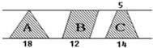

# Mathematics (Grade 6)

**ID**: 9072ce8b
**难度**: medium_hard
**题型**: multiple_choice

## 题目
如图中，各图形的面积（  ）
A．A的最大
B．B的最大
C．C的最大
D．三个图形一样大

## 解答

**答案**: B

1. Step1:根据图意设三个图形的高都为h
2. Step2:根据三角形面积公式，计算三角形A的面积为18h÷2 = 9h
3. Step3:根据平行四边形面积公式，计算平行四边形B的面积为12h
4. Step4:根据梯形面积公式，计算梯形C的面积为(5 + 14)h÷2 = 9.5h
5. Step5:比较9h、12h、9.5h的大小，得出12h最大，即平行四边形B的面积最大

## 知识点

**知识点**:
  - 面积及面积的大小比较．

---
