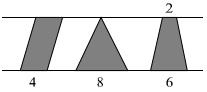

# Mathematics (Grade 6)

**ID**: 90a2eeaf
**难度**: medium_hard
**题型**: multiple_choice

## 题目
图中，平行线间阴影部分的三个图形的面积相比，结果是（）。

A.平行四边形的面积最大
B.三角形的面积最大
C.梯形的面积最大
D.一样大

## 解答

**答案**: D

1. Step1:设平行线间的距离为h
2. Step2:根据平行四边形面积公式S = 底×高，计算平行四边形面积为4×h = 4h
3. Step3:根据三角形面积公式S = 底×高÷2，计算三角形面积为8×h÷2 = 4h
4. Step4:根据梯形面积公式S = (上底 + 下底)×高÷2，计算梯形面积为(2 + 6)×h÷2 = 4h
5. Step5:比较三个图形面积，4h = 4h = 4h，得出它们面积相等，所以答案选D

## 知识点

**知识点**:
  - 梯形的面积;三角形的面积;平行四边形的面积

---
