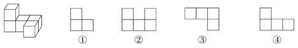

# Mathematics (Grade 6)

**ID**: 91b2445e
**难度**: medium_hard
**题型**: multiple_choice

## 题目
从不同的方向观察下图中左面的立体图形，右面的4个图形中不可能看到的是（   ）。

A．①
B．②
C．③
D．④

## 解答

**答案**: B

1. Step1:分析从前面观察立体图形的情况，可知看到的是两层，下层3个正方形，上层1个正方形靠左，此形状为④
2. Step2:分析从左面观察立体图形的情况，可知看到的是两层，下层2个正方形，上层1个正方形靠左，此形状为①
3. Step3:分析从上面观察立体图形的情况，可知看到的是两层，上层3个正方形，下层1个正方形靠右，此形状为③
4. Step4:对比①②③④，发现不管从哪个方向都看不到②
5. Step5:得出答案为B

## 知识点

**知识点**:
  - 

---
