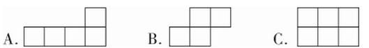

# Mathematics (Grade 6)

**ID**: 9206195d
**难度**: medium_hard
**题型**: multiple_choice

## 题目
用边长1厘米的小正方形，拼成如下的图形， 周长与其他两个不相等的是（）。

## 解答

**答案**: A

1. Step1:明确周长的定义为围绕图形一周的长度
2. Step2:分析图形A，数出其封闭图形最外面一圈包含的边长数量，得出周长为12厘米
3. Step3:分析图形B，数出其封闭图形最外面一圈包含的边长数量，得出周长为10厘米
4. Step4:分析图形C，数出其封闭图形最外面一圈包含的边长数量，得出周长为10厘米
5. Step5:比较A、B、C三个图形的周长，发现A的周长与B、C不同，所以答案是A

## 知识点

**知识点**:
  - 

---
