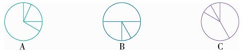

# Mathematics (Grade 6)

**ID**: 9291bfc1
**难度**: medium_hard
**题型**: multiple_choice

## 题目
六（1）班有40名学生，选举班长的得票数为李丽20票，赵刚10票，陈雪6票，王明4票（每人只能投一票）。下列三幅图中，（）图能准确地表示出这一结果。

## 解答

**答案**: B

1. Step1:计算投李丽票的人数占总人数的比例，20÷40=50%
2. Step2:计算投赵刚票的人数占总人数的比例，10÷40=25%
3. Step3:计算投陈雪票的人数占总人数的比例，6÷40=15%
4. Step4:计算投王明票的人数占总人数的比例，4÷40=10%
5. Step5:根据比例特征判断图形，50%的扇形是半圆，25%的扇形的圆心角是90°，符合的图形是B

## 知识点

**知识点**:
  - 扇形统计图;百分数的认识

---
