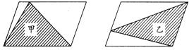

# Mathematics (Grade 6)

**ID**: 92a4d0cf
**难度**: medium_hard
**题型**: multiple_choice

## 题目
如图是两个完全一样的平行四边形，则两图中的阴影部分面积的关系是(  )
A．甲＞乙
B．甲＜乙
C．甲=乙

## 解答

**答案**: C

1. Step1:明确两个平行四边形完全一样，所以它们的面积相等
2. Step2:观察发现两图中阴影部分均为对应平行四边形面积的一半
3. Step3:因为平行四边形面积相等且阴影部分都是其面积的一半，所以得出两图中阴影部分面积相等，答案选C

## 知识点

**知识点**:
  - 面积及面积的大小比较．

---
