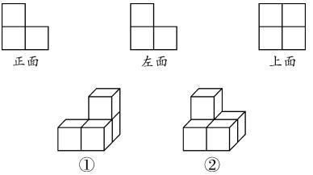

# Mathematics (Grade 6)

**ID**: 9381049f
**难度**: medium_hard
**题型**: multiple_choice

## 题目
选择正确答案的序号填在括号里。
小青用同样大小的几个小正方体搭成了一个立体图形，小明从正面、左面和上面看分别是以下图形。正确的立体图形是（）

## 解答

**答案**: ②

1. Step1:根据从上面看到的图形，可知最底层有4个小正方体
2. Step2:依据从正面和左面看到的图形，判断出第二层有1个小正方体
3. Step3:对比①和②，①中第二层有2个小正方体，②中第二层有1个小正方体，所以正确的立体图形是②

## 知识点

**知识点**:
  - 从三个不同方向观察物体

---
