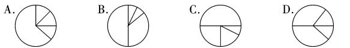

# Mathematics (Grade 6)

**ID**: 93d71bc2
**难度**: medium_hard
**题型**: multiple_choice

## 题目
六（2）班有40名学生，选举班长的得票数为：李明20票，张兵10票，邓江6票，王辉4票。下列四幅图中，能准确表示结果的是（）。

## 解答

**答案**: C

1. Step1:计算李明得票数占总人数的比例，20÷40=50%
2. Step2:计算张兵得票数占总人数的比例，10÷40=25%
3. Step3:计算邓江得票数占总人数的比例，6÷40=15%
4. Step4:计算王辉得票数占总人数的比例，4÷40=10%
5. Step5:因为50%对应的扇形是半圆，25%对应的扇形圆心角是90°，观察选项，只有C选项符合这些比例特征，所以答案是C

## 知识点

**知识点**:
  - 扇形统计图的认识及绘制;百分数应用题

---
