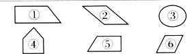

# Mathematics (Grade 6)

**ID**: 945ba09b
**难度**: medium_hard
**题型**: multiple_choice

## 题目
下面图形中，（  ）和（  ）是平行四边形．
A．①④
B．②⑤
C．③⑥
D．②⑥

## 解答

**答案**: D

1. Step1:明确平行四边形的定义为有两组对边平行的四边形
2. Step2:观察图形①，发现它只有一组对边平行，不是平行四边形
3. Step3:观察图形②，它有两组对边平行，是平行四边形
4. Step4:观察图形③，它是圆形，不是四边形，更不是平行四边形
5. Step5:观察图形④，它是五边形，不是平行四边形
6. Step6:观察图形⑤，它只有一组对边平行，不是平行四边形
7. Step7:观察图形⑥，它有两组对边平行，是平行四边形
8. Step8:根据观察结果，得出②和⑥是平行四边形，所以答案选D

## 知识点

**知识点**:
  - 平面图形的分类及识别．

---
