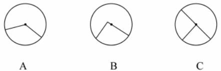

# Mathematics (Grade 6)

**ID**: 967834de
**难度**: medium_hard
**题型**: multiple_choice

## 题目
下列图形中，（）图中的两条线段的长度相等。

## 解答

**答案**: A

1. Step1:明确本题考点是圆的认识，关键在于根据半径的概念及性质判断线段长度关系
2. Step2:回忆圆心与圆上任意一点的连线叫做半径，且在同一个圆内所有半径都相等
3. Step3:观察A图，发现其中两条线段是圆上的两条半径
4. Step4:根据圆半径的性质，得出A图中两条线段长度相等
5. Step5:对比选项，确定答案为A

## 知识点

**知识点**:
  - 圆的认识

---
