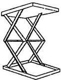

# Mathematics (Grade 6)

**ID**: 97f728dd
**难度**: medium_hard
**题型**: multiple_choice

## 题目
如右图所示，这个小小的升降机应用的原理是（  ）
A．三角形的稳定性
B．三角形的内角和是180°
C．三角形很美丽

## 解答

**答案**: A

1. Step1:明确题目是询问右图中小小升降机应用的原理
2. Step2:依据三角形的特性相关知识，知道三角形具有稳定性等特性
3. Step3:根据解析2可知，该升降机应用的原理是三角形的稳定性
4. Step4:对比选项，A选项为三角形的稳定性，符合要求，所以答案是A

## 知识点

**知识点**:
  - 三角形的特性．

---
