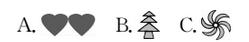

# Mathematics (Grade 6)

**ID**: 982257cf
**难度**: medium_hard
**题型**: multiple_choice

## 题目
选择题。
下图中（）是由旋转得到的图案。

## 解答

**答案**: C

1. Step1:明确旋转的定义，即一个物体围绕一个中心点作圆周运动，旋转前后图形大小和形状不变，只是自身方向和位置改变
2. Step2:分析选项A，发现其是由平移得到的图案
3. Step3:分析选项B，得出其既不是平移也不是旋转
4. Step4:分析选项C，确定其是由旋转得到的图案
5. Step5:根据上述分析，得出答案为C

## 知识点

**知识点**:
  - 旋转

---
