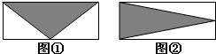

# Mathematics (Grade 6)

**ID**: 987e867e
**难度**: medium_hard
**题型**: multiple_choice

## 题目
两个完全相同的长方形（如图），将图①和图②阴影部分的面积相比，（  ）
$\begin{description}
\item A．图①大\item B．图②大\item C．图①和图②相等
\end{description}$

## 解答

**答案**: C

1. Step1:明确两个长方形完全相同
2. Step2:观察图①，可知其阴影部分三角形的底是长方形的长，高是长方形的宽，根据三角形面积公式S = 底×高÷2，可得图①阴影部分面积为长方形面积的一半
3. Step3:观察图②，可知其阴影部分三角形的底是长方形的宽，高是长方形的长，根据三角形面积公式S = 底×高÷2，可得图②阴影部分面积为长方形面积的一半
4. Step4:因为两个长方形相同，且图①和图②阴影部分面积都为长方形面积的一半，所以图①和图②阴影部分面积相等，答案选C

## 知识点

**知识点**:
  - 面积及面积的大小比较．

---
