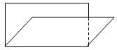

# Mathematics (Grade 6)

**ID**: 993f2a6f
**难度**: medium_hard
**题型**: multiple_choice

## 题目
如图，长方形的面积和平行四边形面积比较，谁的面积大(  )
A．长方形
B．平行四边形
C．无法确定

## 解答

**答案**: C

1. Step1:明确长方形面积公式为长×宽，平行四边形面积公式为底×高
2. Step2:观察图形可知长方形的长与平行四边形的底相等
3. Step3:由于长方形的宽和与之对应的平行四边形的高的大小关系无法确定
4. Step4:根据面积公式，因为底相等但高的大小关系不确定，所以长方形和平行四边形的面积无法确定

## 知识点

**知识点**:
  - 长方形、正方形的面积;平行四边形的面积．

---
