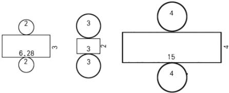

# Mathematics (Grade 6)

**ID**: 9a387b2f
**难度**: medium_hard
**题型**: multiple_choice

## 题目
下面哪个图形是圆柱的展开图？（图中单位：cm）

## 解答

**答案**: ①

1. Step1:根据圆柱展开图特点，侧面长方形的长等于圆柱底面周长。对于第一个图形，底面直径为2cm，由圆的周长公式C = πd（π取3.14）可得底面周长为3.14×2 = 6.28cm，此图形中长方形的长也为6.28cm，所以第一个图形是圆柱的展开图。
2. Step2:对于第二个图形，底面直径为3cm，根据圆的周长公式C = πd（π取3.14），底面周长为3.14×3 = 9.42cm，而图形中长方形的长为3cm，两者不相等，所以第二个图形不是圆柱的展开图。
3. Step3:对于第三个图形，底面直径为4cm，由圆的周长公式C = πd（π取3.14）可知底面周长为3.14×4 = 12.56cm，图形中长方形的长为15cm，两者不相等，所以第三个图形不是圆柱的展开图。
4. Step4:综上，只有第一个图形是圆柱的展开图，答案为['①']。

## 知识点

**知识点**:
  - 圆柱的展开图．

---
