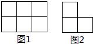

# Mathematics (Grade 6)

**ID**: 9acc9f3e
**难度**: medium_hard
**题型**: multiple_choice

## 题目
一个物体由若干个小的正方体摆成，从上面看到的是图1，从左面看到的是图2．这个物体最多由（  ）个小正方体摆成．
A．8
B．9
C．10

## 解答

**答案**: B

1. Step1:根据从上面看到的图1，可知物体的上面一层有6个小正方体
2. Step2:根据从左面看到的图2以及题意分析，可知物体下面一层最多有3个小正方体
3. Step3:将上面一层的小正方体数量6和下面一层最多的小正方体数量3相加，即6 + 3 = 9个，得到这个物体最多由9个小正方体摆成
4. Step4:对比选项，答案是B

## 知识点

**知识点**:
  - 从不同方向观察物体和几何体．

---
