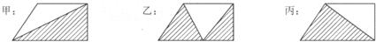

# Mathematics (Grade 6)

**ID**: 9b1de361
**难度**: medium_hard
**题型**: multiple_choice

## 题目
下面三个完全一样的直角梯形中，阴影部分的面积（  ）

A．甲最大
B．乙最大
C．丙最大
D．一样大

## 解答

**答案**: D

1. Step1:明确三个直角梯形完全相同
2. Step2:观察发现甲图中阴影部分是一个以梯形下底为底，梯形高为高的三角形
3. Step3:观察发现乙图中阴影部分两个三角形的底之和为梯形下底，高为梯形的高，根据三角形面积公式可知其总面积等于以梯形下底为底，梯形高为高的三角形的面积
4. Step4:观察发现丙图中阴影部分是一个以梯形下底为底，梯形高为高的三角形
5. Step5:因为三个梯形完全相同，所以它们下底和高都分别相等，根据三角形面积公式，得出三个图中阴影部分面积都相等，所以答案是D

## 知识点

**知识点**:
  - 面积及面积的大小比较．

---
