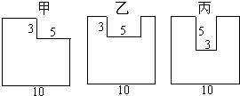

# Mathematics (Grade 6)

**ID**: 9b799205
**难度**: medium_hard
**题型**: multiple_choice

## 题目
如图，在三张边长都是10厘米的正方形纸版上，分别剪下一个长5厘米，宽3厘米的长方形，剩下图形（  ）的周长最长．

A．甲
B．乙
C．丙

## 解答

**答案**: C

1. Step1:分析甲的周长变化，甲从正方形一个角上剪去长方形，剪去的两条边的长度等于又露出的两条边的长度，所以甲剩下图形的周长不变，仍为原来正方形的周长10×4=40厘米
2. Step2:分析乙的周长变化，乙从正方形1条边上剪去长方形，周长比原来增加了3×2=6厘米，那么乙剩下图形的周长为10×4 + 6 = 46厘米
3. Step3:分析丙的周长变化，丙从正方形1条边上剪去长方形，周长比原来增加了5×2=10厘米，那么丙剩下图形的周长为10×4 + 10 = 50厘米
4. Step4:比较甲、乙、丙剩下图形的周长，40＜46＜50，所以丙剩下图形的周长最长

## 知识点

**知识点**:
  - 巧算周长．

---
