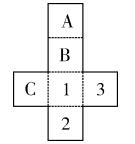

# Mathematics (Grade 6)

**ID**: 9cd95cdf
**难度**: medium_hard
**题型**: multiple_choice

## 题目
下图是一个正方体纸盒的展开图，若在其中的三个正方形A，B，C内分别填入适当的数，使得它们折成正方体后相对面上的两个数的和为4，则填入正方形A，B，C内的三个数依次为（）。

A.3，2，1
B.2，3，1
C.3，1，2
D.1，2，3

## 解答

**答案**: A

1. Step1:根据正方体展开图中“相隔必相对”的性质，得出A与1相对，B与2相对，C与3相对
2. Step2:因为折成正方体后相对面上的两个数的和为4，所以得到A + 1 = 4，B + 2 = 4，C + 3 = 4
3. Step3:由A + 1 = 4，计算得出A = 3；由B + 2 = 4，计算得出B = 2；由C + 3 = 4，计算得出C = 1
4. Step4:对比选项，A选项3，2，1符合计算结果，所以答案是A

## 知识点

**知识点**:
  - 长、正方体的展开与折叠

---
