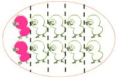

# Mathematics (Grade 6)

**ID**: 9e54aafe
**难度**: medium_hard
**题型**: multiple_choice

## 题目
如图所示，用分数表示正确的是（  ）

$\begin{description}
\item A．\frac{1}{3}\item B．\frac{1}{4}\item C．\frac{1}{5}
\end{description}$

## 解答

**答案**: C

1. Step1:明确将所有小鸡的只数看作单位'1'
2. Step2:观察发现小鸡被平均分成了5份
3. Step3:看到涂色部分占了其中的1份
4. Step4:根据分数的意义，得出用分数表示为1/5
5. Step5:对比选项，选择C

## 知识点

**知识点**:
  - 分数的意义、读写及分类．

---
