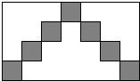

# Mathematics (Grade 6)

**ID**: 9ef581f8
**难度**: medium_hard
**题型**: multiple_choice

## 题目
如图，每个小方格的边长是1厘米，大长方形的面积是（  ）

$\begin{description}
\item A．7平方厘米\item B．10平方厘米\item C．16平方厘米\item D．28平方厘米
\end{description}$

## 解答

**答案**: D

1. Step1:观察图形，确定大长方形的长由7个小方格的边长组成，因为每个小方格边长是1厘米，所以大长方形的长为7×1 = 7厘米
2. Step2:观察图形，确定大长方形的宽由4个小方格的边长组成，因为每个小方格边长是1厘米，所以大长方形的宽为4×1 = 4厘米
3. Step3:根据长方形面积公式，长方形面积 = 长×宽，将长7厘米和宽4厘米代入公式，可得面积为7×4 = 28平方厘米
4. Step4:对比选项，发现面积为28平方厘米的是D选项，所以答案是D

## 知识点

**知识点**:
  - 长方形、正方形的面积．

---
