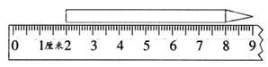

# Mathematics (Grade 6)

**ID**: 9f8a19da
**难度**: medium_hard
**题型**: multiple_choice

## 题目
下图中的铅笔的长度是（  ）。

A．9厘米
B．2厘米
C．7厘米

## 解答

**答案**: C

1. Step1:明确测量物体长度的方法，当物体左端对准的不是0刻度时，要用右端的刻度数减去左端的刻度数才是物体的长度
2. Step2:观察图中铅笔，其左端对准2厘米刻度处，右端对准9厘米刻度处
3. Step3:根据上述方法计算铅笔长度，即9 - 2 = 7（厘米）
4. Step4:对比选项，得出答案为C

## 知识点

**知识点**:
  - 

---
