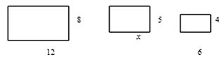

# Mathematics (Grade 6)

**ID**: a0c658fa
**难度**: medium_hard
**题型**: multiple_choice

## 题目
下面的图形是按一定的比例缩小的，x是（ ）．

$\begin{description}
\item A．10\item B．8\item C．7.5\item D．6
\end{description}$

## 解答

**答案**: C

1. Step1:因为图形是按一定比例缩小的，所以对应边成比例，可得长的比例关系为x：12 = 5：8，进而转化为x：5 = 12：8
2. Step2:根据比例的基本性质“两内项之积等于两外项之积”，由x：5 = 12：8得到8x = 5×12
3. Step3:计算5×12 = 60，即8x = 60
4. Step4:求解x，x = 60÷8 = 7.5
5. Step5:得出答案，x是7.5，对应选项C

## 知识点

**知识点**:
  - 小学数学;数与代数;比和比例;比例;比例尺的意义

---
