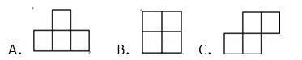

# Mathematics (Grade 6)

**ID**: a17ac972
**难度**: medium_hard
**题型**: multiple_choice

## 题目
用4个边长为1厘米的正方形拼摆成下面的图形，第（）个图形的周长最短。

## 解答

**答案**: B

1. Step1:明确周长的定义为围成封闭图形一周的长度。
2. Step2:计算A图形的周长，通过数小正方形边长可得3+3+2+2=10厘米。
3. Step3:计算B图形的周长，通过数小正方形边长可得2+2+2+2=8厘米。
4. Step4:计算C图形的周长，通过数小正方形边长可得3+3+2+2=10厘米。
5. Step5:比较三个图形的周长，8厘米<10厘米，得出B图形周长最短。
6. Step6:得出答案为B。

## 知识点

**知识点**:
  - 周长的认识

---
