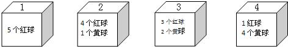

# Mathematics (Grade 6)

**ID**: a2eaed76
**难度**: medium_hard
**题型**: multiple_choice

## 题目
如图从（  ）号箱子里摸到红球可能性是20%：

$\begin{description}
\item A．1号\item B．2号\item C．3号\item D．4号
\end{description}$

## 解答

**答案**: D

1. Step1:计算1号箱子摸到红球的可能性，红球有5个，总球数为5个，用红球个数除以总球数，即5÷5 = 100%
2. Step2:计算2号箱子摸到红球的可能性，红球有4个，黄球有1个，总球数为4 + 1 = 5个，用红球个数除以总球数，即4÷(4 + 1) = 80%
3. Step3:计算3号箱子摸到红球的可能性，红球有3个，黄球有2个，总球数为3 + 2 = 5个，用红球个数除以总球数，即3÷(3 + 2) = 60%
4. Step4:计算4号箱子摸到红球的可能性，红球有1个，黄球有4个，总球数为1 + 4 = 5个，用红球个数除以总球数，即1÷(1 + 4) = 20%
5. Step5:对比四个箱子摸到红球的可能性，发现4号箱子摸到红球可能性是20%，所以从4号箱子里摸到红球可能性是20%

## 知识点

**知识点**:
  - 简单事件发生的可能性求解．

---
