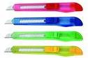

# Mathematics (Grade 6)

**ID**: a2f40e7b
**难度**: medium_hard
**题型**: multiple_choice

## 题目
买4把小刀用去7.5元，买同样的6把小刀用去多少元？列式正确的是（  ）
$\begin{description}
\item A．7.5÷4×6\item B．7.5÷（6÷4）\item C．6÷（7.5÷4）
\end{description}$

## 解答

**答案**: A

1. Step1:根据已知条件，买4把小刀用去7.5元，先根据除法的意义求出每把小刀的单价，即7.5÷4元。
2. Step2:再根据乘法的意义，用求出的每把小刀的单价乘6，得到买6把小刀需要的钱数，列式为7.5÷4×6。
3. Step3:对比选项，发现A选项为7.5÷4×6，符合所求列式。

## 知识点

**知识点**:
  - 简单的归一应用题．

---
