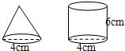

# Mathematics (Grade 6)

**ID**: a3761105
**难度**: medium_hard
**题型**: multiple_choice

## 题目
右图中圆锥体积是圆柱体积的$\frac{1}{3}$，那么圆锥的高是（  ）cm．
A．2
B．6
C．18

## 解答

**答案**: B

1. Step1:根据题目可知圆锥体积是圆柱体积的$\frac{1}{3}$
2. Step2:观察图形可知圆柱与圆锥底面直径均为4cm，所以它们底面积相等
3. Step3:由等底等高的圆锥的体积是圆柱的体积的$\frac{1}{3}$这一性质，结合前面条件可得圆柱与圆锥的高相等
4. Step4:已知圆柱的高是6cm，所以圆锥的高也是6cm，答案选B

## 知识点

**知识点**:
  - 圆锥的体积；圆柱的侧面积、表面积和体积．

---
