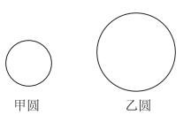

# Mathematics (Grade 6)

**ID**: a3b41eaa
**难度**: medium_hard
**题型**: multiple_choice

## 题目
下图中两个圆的半径各增加1厘米后，哪个圆的周长增加的多？
A.甲圆
B.乙圆
C.一样多

## 解答

**答案**: C

1. Step1:明确圆的周长公式为 C = 2πr，其中 C 表示周长，r 表示半径
2. Step2:当半径增加 1 厘米时，新的半径为 r + 1，此时新的周长 C' = 2π(r + 1)
3. Step3:对 C' = 2π(r + 1)进行展开，得到 C' = 2πr + 2π
4. Step4:计算周长的增加量，用新周长 C'减去原来的周长 C，即 C' - C = (2πr + 2π) - 2πr = 2π
5. Step5:可知无论原来圆的半径 r 是多少，半径增加 1 厘米时，周长都增加 2π厘米，所以甲圆和乙圆周长增加的一样多，答案选 C

## 知识点

**知识点**:
  - 圆的周长

---
