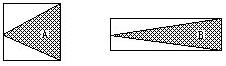

# Mathematics (Grade 6)

**ID**: a472a957
**难度**: medium_hard
**题型**: multiple_choice

## 题目
如图是两个面积相等的长方形，图中阴影部分的大小关系是（  ）

$\begin{description}
\item A．A=B\item B．A＞B\item C．B＞A\item D．无法判断
\end{description}$

## 解答

**答案**: A

1. Step1:明确三角形面积公式为底×高÷2，长方形面积公式为长×宽
2. Step2:观察图A，其三角形的底是长方形的长，高是长方形的宽，根据公式可得其面积为长方形面积的一半
3. Step3:观察图B，其三角形的底是长方形的长，高是长方形的宽，根据公式可得其面积为长方形面积的一半
4. Step4:因为两个长方形面积相等，且图A、图B中三角形面积都为各自长方形面积的一半，所以图A和图B中阴影部分面积相等
5. Step5:根据选项，得出答案为A

## 知识点

**知识点**:
  - 面积及面积的大小比较．

---
