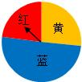

# Mathematics (Grade 6)

**ID**: a4ae3a58
**难度**: medium_hard
**题型**: multiple_choice

## 题目
如图，转动转盘，转盘停止转动时指针指向（  ）区域的可能性最大．
$\begin{description}
\item A．红色\item B．黄色\item C．蓝色\item D．红色和黄色
\end{description}$

## 解答

**答案**: C

1. Step1:明确指针指向区域的可能性大小与该区域面积和总面积的关系，即指针指向区域的概率是所指区域的面积与总面积的比
2. Step2:观察转盘，发现蓝色区域的面积在红、黄、蓝三种颜色区域中是最大的
3. Step3:根据上述关系和观察结果，得出转动转盘停止后指针指向蓝色区域的可能性最大，所以答案选C

## 知识点

**知识点**:
  - 可能性的大小．

---
