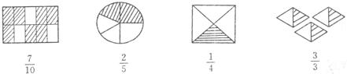

# Mathematics (Grade 6)

**ID**: a5fad908
**难度**: medium_hard
**题型**: multiple_choice

## 题目
下列各图，用分数表示图中阴影部分与整体的关系，正确的个数有（  ）

A．1个
B．2个
C．3个
D．4个

## 解答

**答案**: B

1. Step1:根据分数的意义，分析图一，长方形被平均分成10份，阴影部分为7份，得出阴影部分占整个图形的7/10，该表示正确
2. Step2:依据分数的意义，判断图二，圆没有被平均分成5份，所以不能用2/5表示，该表示错误
3. Step3:按照分数的意义，研究图三，正方形被平均分成4份，阴影部分为1份，得出阴影部分占整个图形的1/4，该表示正确
4. Step4:根据分数的意义，剖析图四，三个三角形被平均分成6份，阴影部分为3份，得出阴影部分占这三个三角形的3/6即1/2，而不是3/3，该表示错误
5. Step5:统计正确表示的个数为2个，得出答案为B

## 知识点

**知识点**:
  - 分数的意义、读写及分类．

---
