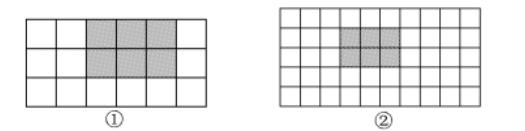

# Mathematics (Grade 6)

**ID**: a689c503
**难度**: medium_hard
**题型**: multiple_choice

## 题目
下面两幅图形中的阴影部分都占6格，阴影部分的面积相比，（）

A.图①中的大
B.图②中的大
C.一样大

## 解答

**答案**: A

1. Step1:明确两个图形阴影部分都占6格
2. Step2:根据面积定义，面积是所占平面图形的大小
3. Step3:观察发现图①的每个正方形的面积比图②每个正方形的面积大
4. Step4:因为阴影部分格数相同，单个正方形面积大的图形其阴影部分面积大，所以图①阴影部分面积大，答案选A

## 知识点

**知识点**:
  - 面积的认识

---
