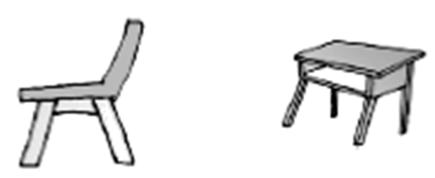

# Mathematics (Grade 6)

**ID**: a6b1ae95
**难度**: medium_hard
**题型**: multiple_choice

## 题目
买一套课桌椅要花（    ）元。 

 160元      是椅子价钱的4倍
$\begin{description}
\item A.40\item B.640\item C.800
\end{description}$

## 解答

**答案**: C

1. Step1:已知椅子价格是160元，课桌价格是椅子价钱的4倍，根据倍数关系，用椅子价格160元乘以4，即160×4，可求出课桌的价格为640元。
2. Step2:求一套课桌椅的价格，就是将椅子价格和课桌价格相加，椅子价格160元，课桌价格640元，即160 + 640，得出一套课桌椅价格为800元。
3. Step3:对比选项，800元对应的选项是C，所以答案选C。

## 知识点

**知识点**:
  - 

---
