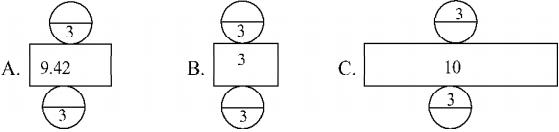

# Mathematics (Grade 6)

**ID**: a9379ece
**难度**: medium_hard
**题型**: multiple_choice

## 题目
下面各图中，是圆柱的展开图是（）。（单位：cm）

## 解答

**答案**: A

1. Step1:明确圆柱展开图特点，圆柱两底面是圆，侧面是长为圆柱底面周长的长方形
2. Step2:已知底面圆直径为3cm，根据圆的周长公式C = πd（其中C为周长，d为直径，π取3.14），计算底面圆周长为3×3.14 = 9.42cm
3. Step3:判断选项，A选项中长方形的长为9.42cm，符合底面圆的周长等于长方形侧面的长这一条件，B选项长方形长为3cm不符合，C选项长方形长为10cm不符合，所以是圆柱展开图的是A

## 知识点

**知识点**:
  - 圆柱与圆锥的展开图

---
