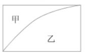

# Mathematics (Grade 6)

**ID**: a9a437c0
**难度**: medium_hard
**题型**: multiple_choice

## 题目
下面关于图中甲、乙两个图形关系的说法，正确的是（）

A.甲的面积与乙的面积相等，周长也相等
B.乙的面积大于甲的面积，但周长相等
C.乙的面积大于甲的面积，周长也比甲的稍长一点

## 解答

**答案**: B

1. Step1:根据图形面积的定义，即图形的大小，通过观察判断出乙的面积大于甲的面积
2. Step2:依据图形周长的定义，可知两个图形有一条公共边，其它两边分别两两相等
3. Step3:由上述周长情况得出甲、乙两个图形的周长相等
4. Step4:综合面积和周长的比较结果，得出乙的面积大于甲的面积，但周长相等，所以答案选B

## 知识点

**知识点**:
  - 面积单位的认识、进率及换算;周长的认识

---
