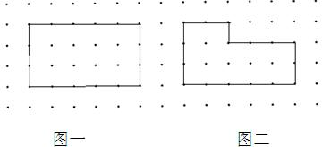

# Mathematics (Grade 6)

**ID**: ab82f5ed
**难度**: medium_hard
**题型**: multiple_choice

## 题目
如图两个图形的周长(  )
A．图一短，图二长
B．图一长，图二短
C．一样长

## 解答

**答案**: C

1. Step1:把两个点之间的距离看作单位'1'。
2. Step2:计算图一的周长，根据长方形周长公式可得(5 + 3)×2 = 16。
3. Step3:计算图二的周长，通过平移可将其转化为一个长方形再加上两条短边，即(5 + 2)×2 + 2 = 16。
4. Step4:比较图一和图二的周长，发现二者均为16，所以两个图形的周长一样长。

## 知识点

**知识点**:
  - 长度比较．

---
