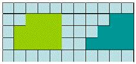

# Mathematics (Grade 6)

**ID**: aba1ae08
**难度**: medium_hard
**题型**: multiple_choice

## 题目
图中两个图形相比较(  )
A．周长相等，面积不相等
B．周长不相等，面积不相等
C．周长相等，面积也相等

## 解答

**答案**: A

1. Step1:根据周长的含义，计算第一个图形的周长，4+3+3+1+1+2=14
2. Step2:根据周长的含义，计算第二个图形的周长，4+3+2+1+1+1+1+1=14
3. Step3:比较两个图形的周长，因为都是14，所以周长相等
4. Step4:根据面积的含义，计算第一个图形的面积，4×2+3=11
5. Step5:根据面积的含义，计算第二个图形的面积，3×2+2+1=9
6. Step6:比较两个图形的面积，因为11＞9，所以面积不相等
7. Step7:综合周长和面积的比较结果，得出答案为A

## 知识点

**知识点**:
  - 面积及面积的大小比较．

---
