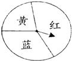

# Mathematics (Grade 6)

**ID**: abbbd8c0
**难度**: medium_hard
**题型**: multiple_choice

## 题目
如图，转盘转到（  ）区域的可能性最大．
A．黄色
B．红色
C．蓝色

## 解答

**答案**: B

1. Step1:明确指针指向区域的可能性与所指区域面积和总面积的关系，即指针指向区域的可能性是所指区域的面积与总面积的比
2. Step2:观察图中黄色、红色、蓝色区域的面积大小，得出红色区域的面积＞蓝色区域的面积＞黄色区域的面积
3. Step3:因为总面积固定，根据上述关系，面积越大，指针指向该区域的可能性越大，所以转动转盘待停止后指针指向红色区域的可能性最大
4. Step4:根据选项，选择答案为B

## 知识点

**知识点**:
  - 可能性的大小．

---
